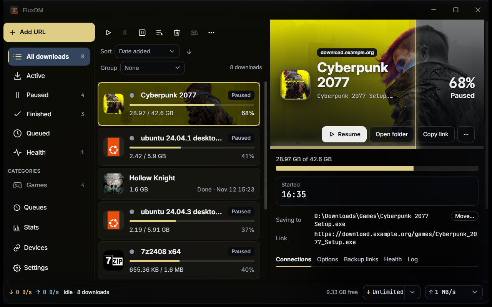
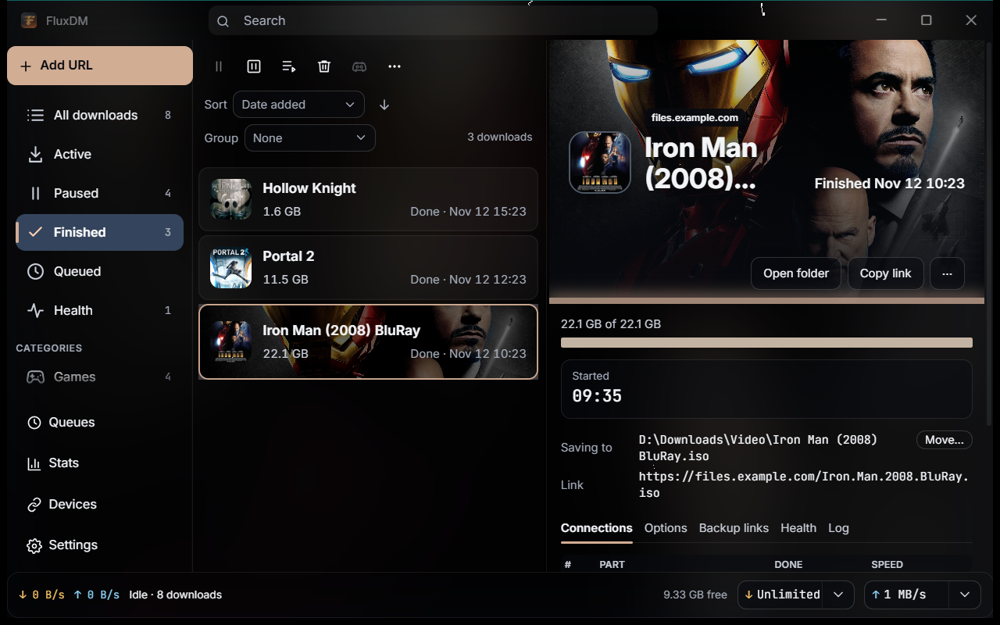
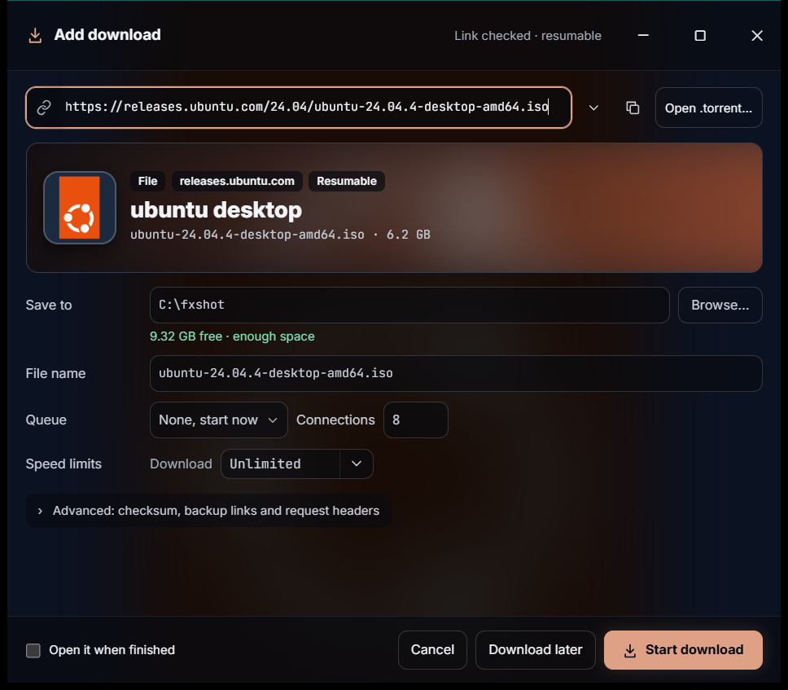
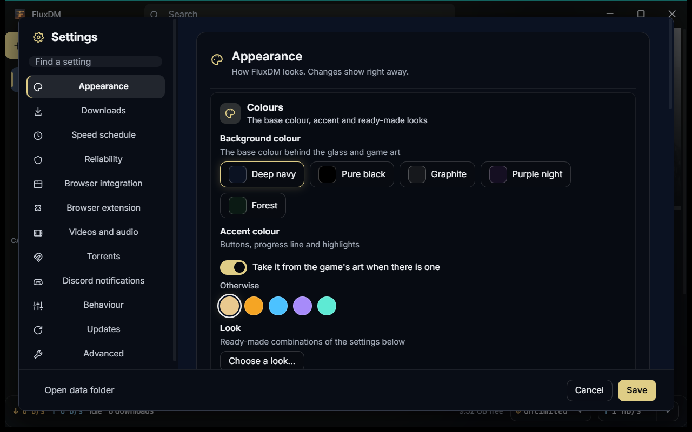
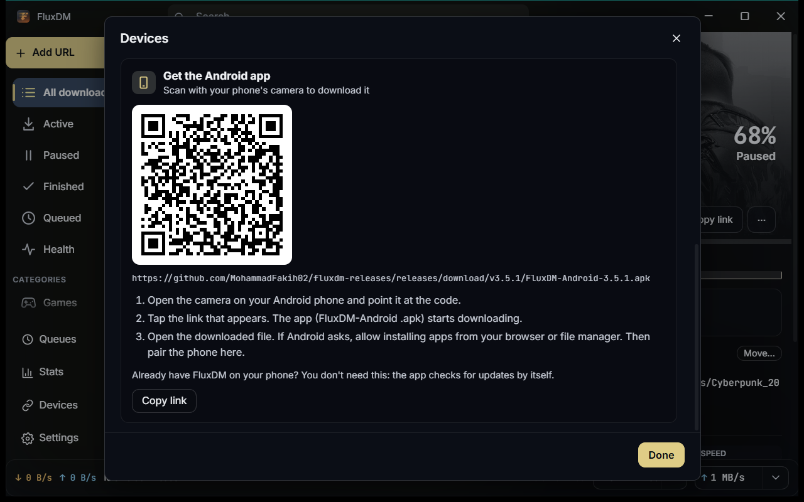
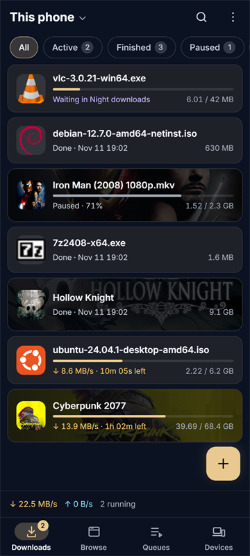
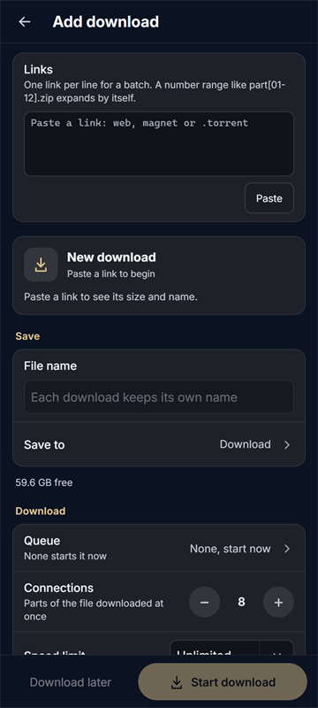
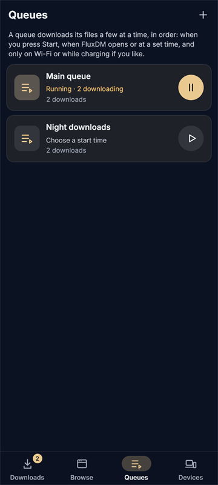
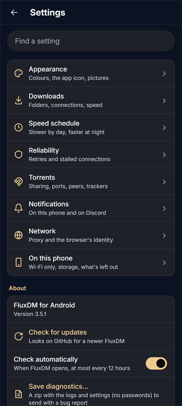

# FluxDM

**A fast, good-looking download manager for Windows and Android.** 
Multi-connection downloads, videos from 1000+ sites and a built-in torrent client in one small app,
and your PC and phone working together.

## Download

| | |
|---|---|
| **Windows 10 / 11** | `FluxDM-Setup-<version>.exe` from the [latest release](https://github.com/MohammadFakih02/fluxdm-releases/releases/latest). Installs for your account only, no admin needed. |
| **Android 7 or newer** | `FluxDM-Android-<version>.apk` from the same release, or scan the QR code in FluxDM on your PC (**Devices → Get the Android app**). |

Both update themselves: FluxDM checks for a new version, verifies its signature and installs it when nothing is
downloading. The files aren't code-signed, so Windows SmartScreen may say "Windows protected your PC": click
**More info → Run anyway**. On Android, allow installing apps from your browser or file manager when asked.

FluxDM needs nothing else installed. On Windows it uses Microsoft Edge WebView2, which comes with Windows 11 and
current Windows 10 (the setup adds it if it's missing).

## Features

### Fast, reliable downloads
- **Up to 64 connections per file.** A connection that finishes early takes over half of the slowest one's work.
- **Survives anything:** pause, crash, reboot or a dropped connection, and the download continues where it stopped.
- **Mirrors** are used in parallel, each one checked to serve the same file first.
- **Expired links** can be refreshed without losing what's already downloaded.
- **Checksums** (MD5, SHA-1, SHA-256, SHA-512) are verified, and Hugging Face's published hashes are picked up automatically.
- **Clear problems, automatic fixes:** temporary failures retry by themselves, stuck connections are replaced, and the
  **Health** page tells you exactly what went wrong with a one-click fix.

### Videos and audio
- YouTube and 1000+ other sites, up to 4K, audio-only MP3/M4A, or whole playlists.
- yt-dlp and FFmpeg are fetched from their official releases the first time you need them.

### Built-in torrent client
- Magnet links and `.torrent` files, with TCP + µTP, DHT, UPnP and fast resume.
- Pick the files you want, **download in order** to watch a video while it downloads, and set separate upload limits
  for downloading and seeding, with a ratio or time target.
- Recheck, reannounce, add trackers, move data, export the `.torrent` or copy the magnet link.

### Organised your way
- **Queues** with a scheduler (days, start and stop times), their own speed limits and retry rules.
- **Speed limits** globally, per queue and per download, plus a speed schedule.
- **When a queue finishes:** exit, sleep, hibernate, shut down or restart, with a countdown you can cancel.
- Categories, sorting, grouping, a table view and **statistics** of what you downloaded.

### Looks good
- **Game and app artwork:** downloads get their real banner and icon from Steam, the Microsoft Store, PlayStation,
  GOG and more, and the window takes on the colours of what you're downloading.
- Five complete looks, background colours, glass styles and app icon colours in **Settings → Appearance**.

### Catches downloads for you
- The **browser extension** for Firefox (signed by Mozilla, one-click install) and Chrome, Edge, Brave, Opera and Vivaldi.
- Copy a link and FluxDM offers to download it. Drag links, `.txt` lists or `.torrent` files onto the window.
- FluxDM can be your `magnet:` link handler.

### Your PC and phone, together
- **Devices:** FluxDM finds your other PCs and your phone on your home network. Pair once, like Bluetooth.
- **See and control** another device's downloads live, right in your own list.
- **Download on another device:** pick it under "Download on" in the Add window.
- **Send files and folders** between devices, with progress on both screens; a broken transfer resumes.
- **Discord notifications** when downloads finish or fail.

 

## FluxDM on Android

The same engine with its own phone screens: Downloads, Browse, Queues and Devices tabs, a download page with
Open and Share, swipe to pause or delete, and a notification per download.

- Queues can wait for **Wi-Fi, the charger or a battery level**, and scheduled queues start on time even after a restart.
- A built-in **browser** keeps sites' sign-ins, so protected downloads just work.
- Links and `.torrent` files shared from other apps open in FluxDM.
- **Arabic** with a right-to-left layout, and layouts for **tablets and landscape**.

Video downloads and the browser extension are Windows-only; **Settings → On this phone** lists what the phone app
does differently and why.

## Privacy and security

- No account, no ads, no telemetry. Your download list and settings stay on your devices.
- Artwork lookups send a download's name to the store it searches (Steam, Microsoft Store…); you can turn them off in Settings → Appearance.
- Updates are signed (Ed25519) and checked before they install.
- Devices talk only on your home network, after you pair them on both screens.

What's new in each version: [CHANGELOG.md](CHANGELOG.md). Found a bug or have an idea?
[Open an issue](https://github.com/MohammadFakih02/fluxdm-releases/issues/new/choose).

## Command line

| | |
|---|---|
| `FluxDM.exe <url or magnet or .torrent path>` | opens the Add window (or hands it to the running copy) |
| `FluxDM.exe --tray` | starts hidden in the tray (used by *Start with Windows*) |
| `FluxDM.exe --exit` | asks the running copy to pause everything, save and quit |
| `FLUXDM_DATA=<folder>` | uses another data folder; such a copy runs beside the normal one (for testing) |

## Credits

[librqbit](https://github.com/ikatson/rqbit) (Apache-2.0), [yt-dlp](https://github.com/yt-dlp/yt-dlp)
(Unlicense, downloaded at runtime), [FFmpeg](https://ffmpeg.org) builds by gyan.dev (GPL, downloaded at
runtime), [Tauri](https://tauri.app) (MIT/Apache-2.0).

## License

[MIT](LICENSE) © 2026 Mohammad Fakih. See [THIRD_PARTY_NOTICES.md](THIRD_PARTY_NOTICES.md) for what FluxDM uses and their licences.
